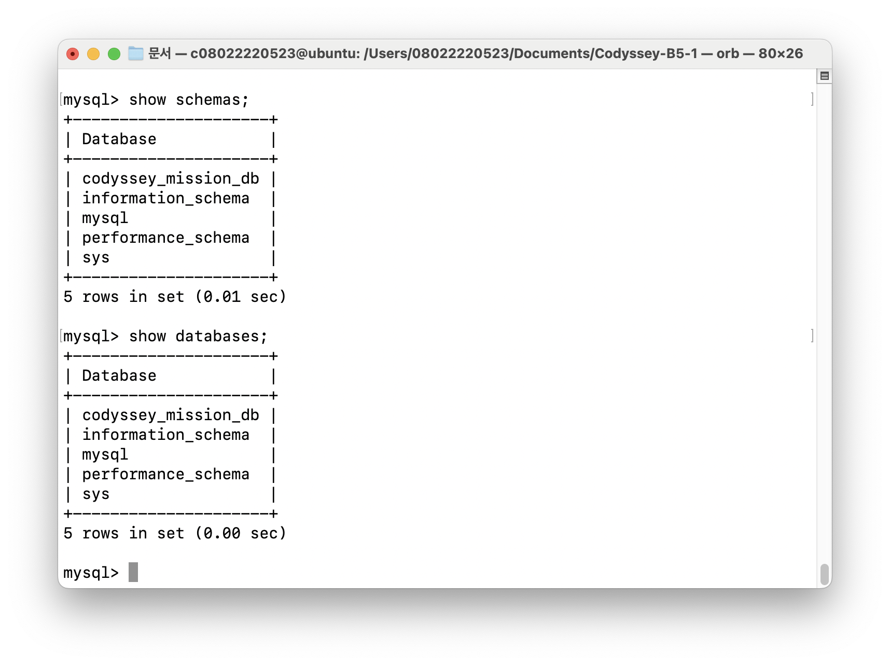
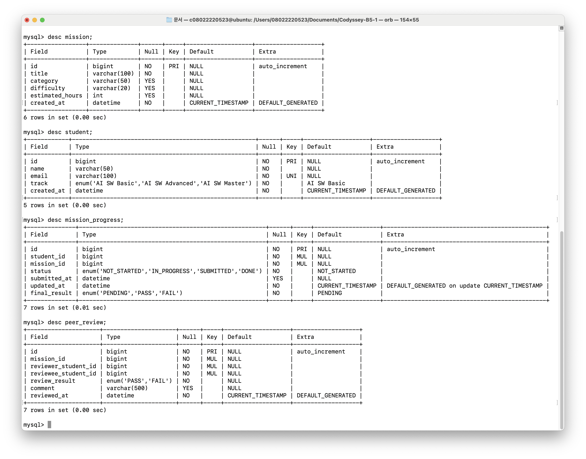
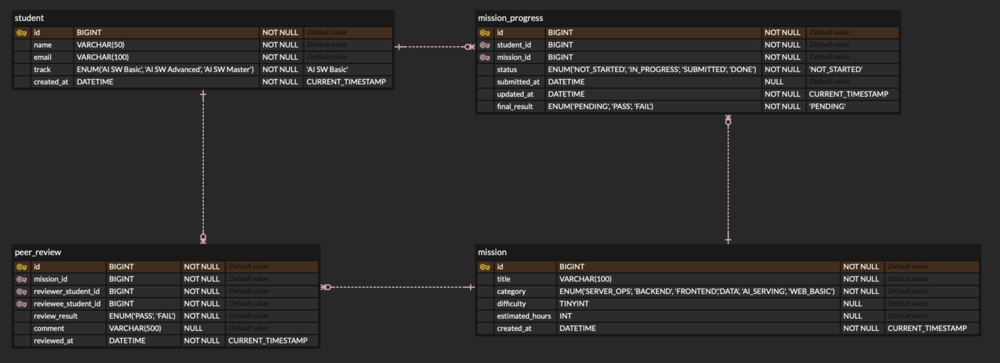

# B5-1 : SQL로 만드는 나만의 데이터베이스
## 미션 개요
이 미션은 백엔드 프레임워크 없이, 도메인에 맞는 테이블 구조를 설계하고 직접 데이터를 넣고, 필요한 정보를 뽑는 전체 흐름을 실습한다.

## 폴더 구조

```text
codyssey-b5-1/
├─ docs/
│  ├─ sql/
│  │  ├─ data.sql
│  │  ├─ query.sql
│  │  └─ schema.sql
│  ├─ scripts/
│  │  ├─ provision.sh
│  │  ├─ 01_install_mysql.sh
│  │  ├─ 02_create_schema.sh
│  │  ├─ 03_insert_data.sh
│  │  └─ 04_execute_query.sh
│  └─ screenshots/
│     ├─ bg-1_ERD.png
│     ├─ b5-1_mysql_started.png
│     ├─ b5-1_schema_created.png
│     ├─ b5-1_table_created.png
│     ├─ b5-1_table_schema_described.png
│     ├─ b5-1_data_inserted.png
│     └─ b5-1_queries_result.png
└─ README.md
```

## 결과물

| 필수 여부 | 파일/폴더명                  | 설명 |
|------|------------------------|------|
| - | `provision.sh`                    | DBMS 설치, DB 생성, 테이블 생성, 쿼리 실행까지의 과정이 자동화된 스크립트 |
| O | `schema.sql`                   | 데이터베이스의 테이블 구조(DDL)를 정의한 SQL 스크립트. DB를 처음 만들 때 실행 |
| O | `data.sql`                     | 테이블에 넣을 샘플 데이터 INSERT 문들을 모아 둔 SQL 스크립트 |
| O | `query.sql`                    | 과제 요구사항에 맞춰 작성한 15개 핵심 SQL 쿼리(조회, 조인, 집계, 서브쿼리, 수정·삭제, 인덱스) |
| - | `screenshots`              | MySQL 설치·접속, 스키마 생성, 데이터 삽입, 쿼리 실행 결과를 캡처한 이미지 모음|
| - | `ERD.png`              | 테이블의 구조와 관계를 나타낸 그림|
| O | `README.md`                    | 미션 개요, 핵심 목표, 실행 순서, 폴더 구조, 도메인 및 테이블 설계 내용을 정리한 문서 |


## 요구사항
1. DB 환경 준비
- [x] 설치 (MySQL로 선택)
- [x] 실행 도구 (DBeaver)

2. 데이터 모델 (스키마) 설계

- [x] 최소 4개 테이블 설계

- [x] PK 와 최소 2개 이상의 FK 를 이용한 1: N 관계

- [x] 주제는 직접 선정

3. 제약 조건 적용

- [x] 최소 1개 컬럼에 NOT NULL 적용

- [x] 최소 1개 컬럼에 UNIQUE 적용

- [x] FK 가 없는 값을 참조하지 않아야 한다.

4. 샘플 데이터 준비

- [x] 각 테이블에 최소 10행 이상의 데이터 입력

- [x] FK 로 연결된 데이터가 실제로 관계를 갖도록 입력

5. 핵심 SQL 쿼리 15개 작성

- [x] 기본 조회 4개 이상 (WHERE, ORDER BY, LIMIT 포함)

- [x] 조인 4개 이상 (INNER JOIN 2개 이상, LEFT JOIN 1개 이상 포함)

- [x] 집계 3개 이상 (COUNT, SUM, AVG 중 2개 이상 + GROUP BY)

- [x] 서브쿼리 1개 이상

- [x] 데이터 수정 및 삭제 2개 이상 (UPDATE, DELETE)

- [x] 인덱스 1개 이상 (CREATE INDEX + 적용 이유 1줄)

<br>
<br>

# 1. 실행 절차 (시연)
## 자동 실행 스크립트
```bash
# vm 접속
orb

# git clone & 쉘스크립트 실행
sudo apt-get update \
  && sudo apt-get install -y git \
  && git clone https://github.com/0802222/Codyssey-B5-1.git \
  && cd Codyssey-B5-1 \
  && bash docs/scripts/provision.sh
```

## 수동 실행 절차
1. DB 생성 및 선택
    ```sql
    CREATE DATABASE codyssey_mission_db;
    USE codyssey_mission_db;
    ```
2. 스키마 생성
   ```sql
   SOURCE docs/sql/schema.sql;
   ```

3. 샘플 데이터 삽입
   ```sql
   SOURCE docs/sql/data.sql;
   ```

4. 쿼리 실행
   ```sql
   SOURCE docs/sql/query.sql;
   ```

<br>
<br>

# 2. 과제 수행 내역
리눅스 Ubuntu/Debian 계열 기준

## 1. MySQL 설치
1. 설치
    ```bash
    sudo apt update
    sudo apt install mysql-server
    ```

2. 서비스 시작
    ```bash
    sudo service mysql start

    # 또는
    sudo systemctl start mysql
    ```
    
3. 서비스 상태 확인 (active)
    ```bash
    sudo systemctl status mysql
    ```
    

## 2. MySQL 접속
1. 로그인
    ```bash
    mysql -u root -p
    # 이후 비밀번호 입력
    ```

2. DB 목록확인
    ```sql
    SHOW DATABASES;
    ```
    
    


## 3. DB 생성
1. DB 생성
    ```sql
    CREATE DATABASE <DB이름>;
    CREATE DATABASE codyssey_mission_db;
    ```

2. DB 선택(사용)
    ```sql
    USE <DB이름>;
    USE codyssey_mission_db;
    ```

3. 기타 - DB 삭제
    ```sql
    DROP DATABASE <DB이름>;
    ```

## 4. 테이블 설계
### 주제 : Codyssey 미션관리 
1. `학생 정보` (student)
    
    : id, 이름, 이메일, 과정, 가입일
2. `미션 정보` (mission)
    
    : id, 미션 제목, 카테고리, 난이도, 예상 소요시간, 미션 시작일
3. `진도 관리` (mission_progress)
    
    : id, 학생 id, 미션 id, 진행 상태, 미션 제출일, 수정일, 최종 결과
4. `동료 평가` (peer_review)
    
    : id, 평가자 id, 피평가자 id, 평가 결과 (PASS / FAIL), 코멘트, 작성일


    (* 자세한 내용은 `docs/sql/schema.sql` 파일 참고)

<br>

### 4-1. 테이블 생성
위에서 설계한 4개 테이블을 생성한다.    
```sql
CREATE TABLE 테이블명 (
    컬럼 타입 제약조건,
    컬럼 타입 제약조건
);
```

<br>

### 4-2. 테이블 구조 조회
```sql
DESC 테이블명;
```


<br>
<br>

## 5. ERD


## 6. 쿼리 실행 결과
## 6-1. 조회 (4개 이상)
```sql
-- 전체 학생 목록 (트랙 기준 정렬)
+---------------------------------------------+
+----+--------------+----------------------------+----------------+---------------------+
| id | name         | email                      | track          | created_at          |
+----+--------------+----------------------------+----------------+---------------------+
|  1 | 김백엔       | kimbe_backend@example.com  | AI SW Basic    | 2026-07-25 16:17:04 |
|  3 | 박데브       | park_devops@example.com    | AI SW Basic    | 2026-07-25 16:17:04 |
|  2 | 이프론       | lee_frontend@example.com   | AI SW Basic    | 2026-07-25 16:17:04 |
|  9 | 장코디       | jang_codyssey@example.com  | AI SW Basic    | 2026-07-25 16:17:04 |
|  4 | 최데이터     | choi_data@example.com      | AI SW Basic    | 2026-07-25 16:17:04 |
|  7 | 오서버       | oh_server@example.com      | AI SW Advanced | 2026-07-25 16:17:04 |
|  5 | 정풀스       | jung_fullstack@example.com | AI SW Advanced | 2026-07-25 16:17:04 |
|  6 | 한AI         | han_ai@example.com         | AI SW Advanced | 2026-07-25 16:17:04 |
| 10 | 신알고       | shin_algo@example.com      | AI SW Master   | 2026-07-25 16:17:04 |
|  8 | 유웹         | yoo_web@example.com        | AI SW Master   | 2026-07-25 16:17:04 |
+----+--------------+----------------------------+----------------+---------------------+
```

```sql

-- 특정 트랙의 학생만 조회
+-----------------------------------+
+----+--------------+---------------------------+
| id | name         | email                     |
+----+--------------+---------------------------+
|  1 | 김백엔       | kimbe_backend@example.com |
|  2 | 이프론       | lee_frontend@example.com  |
|  3 | 박데브       | park_devops@example.com   |
|  4 | 최데이터     | choi_data@example.com     |
|  9 | 장코디       | jang_codyssey@example.com |
+----+--------------+---------------------------+
```

```sql
-- 진행 중인 미션 목록
+-----------------------------+
+----+------------+------------+-------------+---------------------+
| id | student_id | mission_id | status      | updated_at          |
+----+------------+------------+-------------+---------------------+
|  3 |          3 |          1 | IN_PROGRESS | 2026-07-25 16:17:04 |
|  7 |          3 |          3 | IN_PROGRESS | 2026-07-25 16:17:04 |
| 11 |          8 |          2 | IN_PROGRESS | 2026-07-25 16:17:04 |
| 13 |         10 |          2 | IN_PROGRESS | 2026-07-25 16:17:04 |
| 17 |          7 |          7 | IN_PROGRESS | 2026-07-25 16:17:04 |
+----+------------+------------+-------------+---------------------+
```

```sql

-- 아직 평가 결과가 PENDING인 진도
+-------------------------------------------+
+------------+------------+-------------+--------------+
| student_id | mission_id | status      | final_result |
+------------+------------+-------------+--------------+
|          1 |          1 | DONE        | PENDING      |
|          2 |          1 | DONE        | PENDING      |
|          3 |          1 | IN_PROGRESS | PENDING      |
|          4 |          1 | NOT_STARTED | PENDING      |
|          1 |          3 | DONE        | PENDING      |
|          2 |          3 | SUBMITTED   | PENDING      |
|          3 |          3 | IN_PROGRESS | PENDING      |
|          5 |          3 | DONE        | PENDING      |
|          8 |          2 | IN_PROGRESS | PENDING      |
|          9 |          2 | NOT_STARTED | PENDING      |
|         10 |          2 | IN_PROGRESS | PENDING      |
|          4 |          5 | DONE        | PENDING      |
|          5 |          5 | NOT_STARTED | PENDING      |
|          6 |          6 | DONE        | PENDING      |
|          7 |          7 | IN_PROGRESS | PENDING      |
|          8 |          8 | NOT_STARTED | PENDING      |
|          9 |         10 | DONE        | PENDING      |
|         10 |         10 | SUBMITTED   | PENDING      |
+------------+------------+-------------+--------------+
```

## 6-2. JOIN (4개 이상)
```sql

-- 학생별 미션 제목과 상태 같이 보기 (INNER JOIN)
+--------------------------------------------------------------+
+--------------+-----------------------------------------------------+-------------+--------------+---------------------+
| student_name | mission_title                                       | status      | final_result | updated_at          |
+--------------+-----------------------------------------------------+-------------+--------------+---------------------+
| 김백엔       | B1-1 시스템 관제 자동화 스크립트 개발               | DONE        | PENDING      | 2026-07-25 16:17:04 |
| 김백엔       | B3-1 Codyssey 미션 관리 DB 설계                     | DONE        | PENDING      | 2026-07-25 16:17:04 |
| 박데브       | B1-1 시스템 관제 자동화 스크립트 개발               | IN_PROGRESS | PENDING      | 2026-07-25 16:17:04 |
| 박데브       | B3-1 Codyssey 미션 관리 DB 설계                     | IN_PROGRESS | PENDING      | 2026-07-25 16:17:04 |
| 신알고       | B2-1 로그 분석 및 모니터링 대시보드                 | IN_PROGRESS | PENDING      | 2026-07-25 16:17:04 |
| 신알고       | C3-1 인덱스와 쿼리 튜닝                             | SUBMITTED   | PENDING      | 2026-07-25 16:17:04 |
| 오서버       | A3-1 React 컴포넌트 설계                            | IN_PROGRESS | PENDING      | 2026-07-25 16:17:04 |
| 오서버       | C2-1 SQL로 보는 데이터 분석                         | DONE        | FAIL         | 2026-07-25 16:17:04 |
| 유웹         | B2-1 로그 분석 및 모니터링 대시보드                 | IN_PROGRESS | PENDING      | 2026-07-25 16:17:04 |
| 유웹         | C1-1 AI 모델 서빙 기초                              | NOT_STARTED | PENDING      | 2026-07-25 16:17:04 |
| 이프론       | B1-1 시스템 관제 자동화 스크립트 개발               | DONE        | PENDING      | 2026-07-25 16:17:04 |
| 이프론       | B3-1 Codyssey 미션 관리 DB 설계                     | SUBMITTED   | PENDING      | 2026-07-25 16:17:04 |
| 장코디       | B2-1 로그 분석 및 모니터링 대시보드                 | NOT_STARTED | PENDING      | 2026-07-25 16:17:04 |
| 장코디       | C3-1 인덱스와 쿼리 튜닝                             | DONE        | PENDING      | 2026-07-25 16:17:04 |
| 정풀스       | A1-1 웹 기초와 HTML/CSS                             | NOT_STARTED | PENDING      | 2026-07-25 16:17:04 |
| 정풀스       | B3-1 Codyssey 미션 관리 DB 설계                     | DONE        | PENDING      | 2026-07-25 16:17:04 |
| 최데이터     | A1-1 웹 기초와 HTML/CSS                             | DONE        | PENDING      | 2026-07-25 16:17:04 |
| 최데이터     | B1-1 시스템 관제 자동화 스크립트 개발               | NOT_STARTED | PENDING      | 2026-07-25 16:17:04 |
| 한AI         | A2-1 JavaScript 비동기 처리                         | DONE        | PENDING      | 2026-07-25 16:17:04 |
| 한AI         | C2-1 SQL로 보는 데이터 분석                         | DONE        | PASS         | 2026-07-25 16:17:04 |
+--------------+-----------------------------------------------------+-------------+--------------+---------------------+
```

```sql

-- 특정 미션(B3-1)에 대한 학생별 진도 현황 (INNER JOIN + WHERE)
+----------------------------------------------------------------------------+
+--------------+-------------+--------------+---------------------+
| student_name | status      | final_result | submitted_at        |
+--------------+-------------+--------------+---------------------+
| 김백엔       | DONE        | PENDING      | 2026-06-25 15:00:00 |
| 박데브       | IN_PROGRESS | PENDING      | NULL                |
| 이프론       | SUBMITTED   | PENDING      | 2026-06-25 16:00:00 |
| 정풀스       | DONE        | PENDING      | 2026-06-26 09:30:00 |
+--------------+-------------+--------------+---------------------+
```

```sql
-- 동료평가 포함해서 학생별 평가 내역 보기 (INNER JOIN)
+-----------------------------------------------------------------------+
+-----------------------------------------------------+-----------+--------------+---------------+------------------------------------------------+---------------------+
| mission_title                                       | 평가자    | 피평가자     | review_result | comment                                        | reviewed_at         |
+-----------------------------------------------------+-----------+--------------+---------------+------------------------------------------------+---------------------+
| A1-1 웹 기초와 HTML/CSS                             | 김백엔    | 최데이터     | PASS          | HTML/CSS 마크업 구조 좋음                      | 2026-07-25 16:17:04 |
| B1-1 시스템 관제 자동화 스크립트 개발               | 이프론    | 김백엔       | PASS          | 로그 구조 설명이 좋음                          | 2026-07-25 16:17:04 |
| B1-1 시스템 관제 자동화 스크립트 개발               | 정풀스    | 박데브       | FAIL          | 방화벽 설정 설명이 부족함                      | 2026-07-25 16:17:04 |
| B1-1 시스템 관제 자동화 스크립트 개발               | 박데브    | 이프론       | PASS          | cron 활용 이해가 좋음                          | 2026-07-25 16:17:04 |
| B2-1 로그 분석 및 모니터링 대시보드                 | 한AI      | 유웹         | PASS          | 대시보드 UX가 좋음                             | 2026-07-25 16:17:04 |
| B2-1 로그 분석 및 모니터링 대시보드                 | 오서버    | 장코디       | PASS          | 쿼리 최적화가 잘 되어 있음                     | 2026-07-25 16:17:04 |
| B3-1 Codyssey 미션 관리 DB 설계                     | 박데브    | 김백엔       | PASS          | FK/제약조건 설계가 자연스러움                  | 2026-07-25 16:17:04 |
| B3-1 Codyssey 미션 관리 DB 설계                     | 정풀스    | 김백엔       | PASS          | 쿼리 15개가 실무 요구 잘 반영됨                | 2026-07-25 16:17:04 |
| B3-1 Codyssey 미션 관리 DB 설계                     | 이프론    | 김백엔       | PASS          | 요구사항대로 테이블 잘 나눴음                  | 2026-07-25 16:17:04 |
| B3-1 Codyssey 미션 관리 DB 설계                     | 정풀스    | 이프론       | PASS          | 쿼리 쪽은 괜찮음                               | 2026-07-25 16:17:04 |
| B3-1 Codyssey 미션 관리 DB 설계                     | 박데브    | 이프론       | FAIL          | 동료평가 로직 설명이 부족함                    | 2026-07-25 16:17:04 |
| B3-1 Codyssey 미션 관리 DB 설계                     | 김백엔    | 이프론       | PASS          | 기본 스키마는 잘 설계됨                        | 2026-07-25 16:17:04 |
| C2-1 SQL로 보는 데이터 분석                         | 김백엔    | 오서버       | FAIL          | 샘플 데이터가 부족함                           | 2026-07-25 16:17:04 |
| C2-1 SQL로 보는 데이터 분석                         | 이프론    | 오서버       | PASS          | 기본 SELECT는 잘 됨                            | 2026-07-25 16:17:04 |
| C2-1 SQL로 보는 데이터 분석                         | 이프론    | 한AI         | PASS          | GROUP BY 활용 좋음                             | 2026-07-25 16:17:04 |
| C2-1 SQL로 보는 데이터 분석                         | 박데브    | 한AI         | PASS          | 인덱스 활용에 대한 이해가 드러남               | 2026-07-25 16:17:04 |
| C2-1 SQL로 보는 데이터 분석                         | 김백엔    | 한AI         | PASS          | 집계 쿼리가 잘 작성되어 있음                   | 2026-07-25 16:17:04 |
+-----------------------------------------------------+-----------+--------------+---------------+------------------------------------------------+---------------------+
```

```sql

-- 진도는 있는데 동료평가가 없는 학생-미션 찾기 (LEFT JOIN
+-----------------------------------------------------------------------------+
+--------------+-----------------------------------------------------+-------------+--------------+
| student_name | mission_title                                       | status      | final_result |
+--------------+-----------------------------------------------------+-------------+--------------+
| 최데이터     | B1-1 시스템 관제 자동화 스크립트 개발               | NOT_STARTED | PENDING      |
| 박데브       | B3-1 Codyssey 미션 관리 DB 설계                     | IN_PROGRESS | PENDING      |
| 정풀스       | B3-1 Codyssey 미션 관리 DB 설계                     | DONE        | PENDING      |
| 신알고       | B2-1 로그 분석 및 모니터링 대시보드                 | IN_PROGRESS | PENDING      |
| 정풀스       | A1-1 웹 기초와 HTML/CSS                             | NOT_STARTED | PENDING      |
| 한AI         | A2-1 JavaScript 비동기 처리                         | DONE        | PENDING      |
| 오서버       | A3-1 React 컴포넌트 설계                            | IN_PROGRESS | PENDING      |
| 유웹         | C1-1 AI 모델 서빙 기초                              | NOT_STARTED | PENDING      |
| 장코디       | C3-1 인덱스와 쿼리 튜닝                             | DONE        | PENDING      |
| 신알고       | C3-1 인덱스와 쿼리 튜닝                             | SUBMITTED   | PENDING      |
+--------------+-----------------------------------------------------+-------------+--------------+
```

## 6-3. 집계 (3개 이상)
```sql
-- 미션별 참여 학생 수 (COUNT + GROUP BY)
+------------------------------------------------+
+-----------------------------------------------------+-------------------+
| mission_title                                       | participant_count |
+-----------------------------------------------------+-------------------+
| B1-1 시스템 관제 자동화 스크립트 개발               |                 4 |
| B3-1 Codyssey 미션 관리 DB 설계                     |                 4 |
| B2-1 로그 분석 및 모니터링 대시보드                 |                 3 |
| A1-1 웹 기초와 HTML/CSS                             |                 2 |
| C2-1 SQL로 보는 데이터 분석                         |                 2 |
| C3-1 인덱스와 쿼리 튜닝                             |                 2 |
| A2-1 JavaScript 비동기 처리                         |                 1 |
| A3-1 React 컴포넌트 설계                            |                 1 |
| C1-1 AI 모델 서빙 기초                              |                 1 |
+-----------------------------------------------------+-------------------+
```

```sql

-- 학생별 완수한 미션 수 (COUNT + GROUP BY)
+---------------------------------------------------+
+--------------+-------------------------+
| student_name | completed_mission_count |
+--------------+-------------------------+
| 김백엔       |                       2 |
| 한AI         |                       2 |
| 이프론       |                       1 |
| 정풀스       |                       1 |
| 오서버       |                       1 |
| 최데이터     |                       1 |
| 장코디       |                       1 |
+--------------+-------------------------+
```

```sql
-- 동료평가 PASS/FAIL 비율 (COUNT + GROUP BY)
+--------------------------------------------------+
+-----------------------------------------------------+---------------+-----------------+---------------+
| mission_title                                       | review_result | count_by_result | ratio_percent |
+-----------------------------------------------------+---------------+-----------------+---------------+
| A1-1 웹 기초와 HTML/CSS                             | FAIL          |               0 |           0.0 |
| A1-1 웹 기초와 HTML/CSS                             | PASS          |               1 |         100.0 |
| A2-1 JavaScript 비동기 처리                         | FAIL          |               0 |          NULL |
| A2-1 JavaScript 비동기 처리                         | PASS          |               0 |          NULL |
| A3-1 React 컴포넌트 설계                            | FAIL          |               0 |          NULL |
| A3-1 React 컴포넌트 설계                            | PASS          |               0 |          NULL |
| B1-1 시스템 관제 자동화 스크립트 개발               | FAIL          |               1 |          33.3 |
| B1-1 시스템 관제 자동화 스크립트 개발               | PASS          |               2 |          66.7 |
| B2-1 로그 분석 및 모니터링 대시보드                 | FAIL          |               0 |           0.0 |
| B2-1 로그 분석 및 모니터링 대시보드                 | PASS          |               2 |         100.0 |
| B3-1 Codyssey 미션 관리 DB 설계                     | FAIL          |               1 |          16.7 |
| B3-1 Codyssey 미션 관리 DB 설계                     | PASS          |               5 |          83.3 |
| B4-1 REST API 설계와 인증                           | FAIL          |               0 |          NULL |
| B4-1 REST API 설계와 인증                           | PASS          |               0 |          NULL |
| C1-1 AI 모델 서빙 기초                              | FAIL          |               0 |          NULL |
| C1-1 AI 모델 서빙 기초                              | PASS          |               0 |          NULL |
| C2-1 SQL로 보는 데이터 분석                         | FAIL          |               1 |          20.0 |
| C2-1 SQL로 보는 데이터 분석                         | PASS          |               4 |          80.0 |
| C3-1 인덱스와 쿼리 튜닝                             | FAIL          |               0 |          NULL |
| C3-1 인덱스와 쿼리 튜닝                             | PASS          |               0 |          NULL |
+-----------------------------------------------------+---------------+-----------------+---------------+
```

## 6-4. 서브쿼리 (1개 이상)
```sql

--동료평가를 한 번도 받아보지 않은 학생 찾기
+--------------------------------------------------------------+
+----+-----------+----------------------------+
| id | name      | email                      |
+----+-----------+----------------------------+
|  5 | 정풀스    | jung_fullstack@example.com |
| 10 | 신알고    | shin_algo@example.com      |
+----+-----------+----------------------------+
```

## 6-5. 데이터 수정 및 삭제 (2개 이상)
수정 전
```sql
mysql> select * from mission_progress;
+----+------------+------------+-------------+---------------------+---------------------+--------------+
| id | student_id | mission_id | status      | submitted_at        | updated_at          | final_result |
+----+------------+------------+-------------+---------------------+---------------------+--------------+
|  1 |          1 |          1 | DONE        | 2026-06-20 10:00:00 | 2026-07-25 16:26:17 | PENDING      |
|  2 |          2 |          1 | DONE        | 2026-06-20 11:00:00 | 2026-07-25 16:26:17 | PENDING      |
|  3 |          3 |          1 | IN_PROGRESS | NULL                | 2026-07-25 16:26:17 | PENDING      |
|  4 |          4 |          1 | NOT_STARTED | NULL                | 2026-07-25 16:26:17 | PENDING      |
|  5 |          1 |          3 | DONE        | 2026-06-25 15:00:00 | 2026-07-25 16:26:17 | PENDING      |
|  6 |          2 |          3 | SUBMITTED   | 2026-06-25 16:00:00 | 2026-07-25 16:26:17 | PENDING      |
|  7 |          3 |          3 | IN_PROGRESS | NULL                | 2026-07-25 16:26:17 | PENDING      |
|  8 |          5 |          3 | DONE        | 2026-06-26 09:30:00 | 2026-07-25 16:26:17 | PENDING      |
|  9 |          6 |          9 | DONE        | 2026-06-19 13:00:00 | 2026-07-25 16:26:17 | PASS         |
| 10 |          7 |          9 | DONE        | 2026-06-19 14:00:00 | 2026-07-25 16:26:17 | FAIL         |
| 11 |          8 |          2 | IN_PROGRESS | NULL                | 2026-07-25 16:26:25 | PENDING      |
| 12 |          9 |          2 | NOT_STARTED | NULL                | 2026-07-25 16:26:25 | PENDING      |
| 13 |         10 |          2 | IN_PROGRESS | NULL                | 2026-07-25 16:26:25 | PENDING      |
| 14 |          4 |          5 | DONE        | NULL                | 2026-07-25 16:26:25 | PENDING      |
| 15 |          5 |          5 | NOT_STARTED | NULL                | 2026-07-25 16:26:25 | PENDING      |
| 16 |          6 |          6 | DONE        | NULL                | 2026-07-25 16:26:25 | PENDING      |
| 17 |          7 |          7 | IN_PROGRESS | NULL                | 2026-07-25 16:26:25 | PENDING      |
| 18 |          8 |          8 | NOT_STARTED | NULL                | 2026-07-25 16:26:25 | PENDING      |
| 19 |          9 |         10 | DONE        | NULL                | 2026-07-25 16:26:25 | PENDING      |
| 20 |         10 |         10 | SUBMITTED   | NULL                | 2026-07-25 16:26:25 | PENDING      |
+----+------------+------------+-------------+---------------------+---------------------+--------------+
20 rows in set (0.01 sec)
```

UPDATE: 동료평가 집계를 반영해 final_result 갱신

수정 후
```sql
mysql> select * from mission_progress;
+----+------------+------------+-------------+---------------------+---------------------+--------------+
| id | student_id | mission_id | status      | submitted_at        | updated_at          | final_result |
+----+------------+------------+-------------+---------------------+---------------------+--------------+
|  1 |          1 |          1 | DONE        | 2026-06-20 10:00:00 | 2026-07-25 16:27:46 | PENDING      |
|  2 |          2 |          1 | DONE        | 2026-06-20 11:00:00 | 2026-07-25 16:27:46 | PENDING      |
|  3 |          3 |          1 | IN_PROGRESS | NULL                | 2026-07-25 16:26:17 | PENDING      |
|  4 |          4 |          1 | NOT_STARTED | NULL                | 2026-07-25 16:26:17 | PENDING      |
|  5 |          1 |          3 | DONE        | 2026-06-25 15:00:00 | 2026-07-25 16:27:46 | PASS         |
|  6 |          2 |          3 | SUBMITTED   | 2026-06-25 16:00:00 | 2026-07-25 16:27:46 | FAIL         |
|  7 |          3 |          3 | IN_PROGRESS | NULL                | 2026-07-25 16:26:17 | PENDING      |
|  8 |          5 |          3 | DONE        | 2026-06-26 09:30:00 | 2026-07-25 16:26:17 | PENDING      |
|  9 |          6 |          9 | DONE        | 2026-06-19 13:00:00 | 2026-07-25 16:27:46 | PASS         |
| 10 |          7 |          9 | DONE        | 2026-06-19 14:00:00 | 2026-07-25 16:27:46 | PENDING      |
| 11 |          8 |          2 | IN_PROGRESS | NULL                | 2026-07-25 16:27:46 | PENDING      |
| 12 |          9 |          2 | NOT_STARTED | NULL                | 2026-07-25 16:27:46 | PENDING      |
| 13 |         10 |          2 | IN_PROGRESS | NULL                | 2026-07-25 16:26:25 | PENDING      |
| 14 |          4 |          5 | DONE        | NULL                | 2026-07-25 16:27:46 | PENDING      |
| 15 |          5 |          5 | NOT_STARTED | NULL                | 2026-07-25 16:26:25 | PENDING      |
| 16 |          6 |          6 | DONE        | NULL                | 2026-07-25 16:26:25 | PENDING      |
| 17 |          7 |          7 | IN_PROGRESS | NULL                | 2026-07-25 16:26:25 | PENDING      |
| 18 |          8 |          8 | NOT_STARTED | NULL                | 2026-07-25 16:26:25 | PENDING      |
| 19 |          9 |         10 | DONE        | NULL                | 2026-07-25 16:26:25 | PENDING      |
| 20 |         10 |         10 | SUBMITTED   | NULL                | 2026-07-25 16:26:25 | PENDING      |
+----+------------+------------+-------------+---------------------+---------------------+--------------+
20 rows in set (0.00 sec)
```

## 6-6. 인덱스 1개 이상 (+ 적용 이유)
인덱스 생성
- 동료평가 조회용 인덱스 생성
- 진도 조회용 인덱스 생성

```sql
-- 복합 인덱스
CREATE INDEX 인덱스명
ON 테이블명 (컬럼1, 컬럼2);

-- 복합 유니크 인덱스 (중복 불가)
CREATE UNIQUE INDEX 인덱스명
ON 테이블명 (컬럼1, 컬럼2);
```

- 자동으로 생성되는 인덱스 들
    - PRIMARY KEY
    - UNIQUE 제약 조건
    - FOREIGN KEY(MySQL InnoDB 특징: FK 선언했는데, 그 컬럼에 인덱스가 없으면 InnoDB가 FK 컬럼에 인덱스를 자동으로 생성한다.)
        이유 : FK 검사를 위해 부모/자식 레코드를 자주 찾고, JOIN을 많이 하므로, 이 컬럼에 인덱스가 없으면 성능이 크게 떨어지기 때문이다.

인덱스 조회
- `Non_unique` : 0 (중복을 허용하지 않는 인덱스, PRIMARY KEY, UNIQUE 제약 등), 1 (중복 허용)
- `Seq_in_index` : 인덱스 안에서 컬럼의 순서 (1부터 시작)
- `Index_type` : 인덱스 자료구조 (보통 BTREE)
- `Cardinality` : 대략적인 유니크 값 개수 추정치
```sql
mysql> SHOW INDEX FROM peer_review;
+-------------+------------+----------------------------------+--------------+---------------------+-----------+-------------+----------+--------+------+------------+---------+---------------+---------+------------+
| Table       | Non_unique | Key_name                         | Seq_in_index | Column_name         | Collation | Cardinality | Sub_part | Packed | Null | Index_type | Comment | Index_comment | Visible | Expression |
+-------------+------------+----------------------------------+--------------+---------------------+-----------+-------------+----------+--------+------+------------+---------+---------------+---------+------------+
| peer_review |          0 | PRIMARY                          |            1 | id                  | A         |          16 |     NULL |   NULL |      | BTREE      |         |               | YES     | NULL       |
| peer_review |          0 | uq_peer_review_unique_pair       |            1 | mission_id          | A         |           5 |     NULL |   NULL |      | BTREE      |         |               | YES     | NULL       |
| peer_review |          0 | uq_peer_review_unique_pair       |            2 | reviewer_student_id | A         |          12 |     NULL |   NULL |      | BTREE      |         |               | YES     | NULL       |
| peer_review |          0 | uq_peer_review_unique_pair       |            3 | reviewee_student_id | A         |          16 |     NULL |   NULL |      | BTREE      |         |               | YES     | NULL       |
| peer_review |          1 | fk_review_reviewer               |            1 | reviewer_student_id | A         |           6 |     NULL |   NULL |      | BTREE      |         |               | YES     | NULL       |
| peer_review |          1 | idx_peer_review_reviewee_mission |            1 | reviewee_student_id | A         |           7 |     NULL |   NULL |      | BTREE      |         |               | YES     | NULL       |
| peer_review |          1 | idx_peer_review_reviewee_mission |            2 | mission_id          | A         |           9 |     NULL |   NULL |      | BTREE      |         |               | YES     | NULL       |
+-------------+------------+----------------------------------+--------------+---------------------+-----------+-------------+----------+--------+------+------------+---------+---------------+---------+------------+
7 rows in set (0.08 sec)

mysql> SHOW INDEX FROM mission_progress;
+------------------+------------+-------------------------------------+--------------+-------------+-----------+-------------+----------+--------+------+------------+---------+---------------+---------+------------+
| Table            | Non_unique | Key_name                            | Seq_in_index | Column_name | Collation | Cardinality | Sub_part | Packed | Null | Index_type | Comment | Index_comment | Visible | Expression |
+------------------+------------+-------------------------------------+--------------+-------------+-----------+-------------+----------+--------+------+------------+---------+---------------+---------+------------+
| mission_progress |          0 | PRIMARY                             |            1 | id          | A         |          20 |     NULL |   NULL |      | BTREE      |         |               | YES     | NULL       |
| mission_progress |          0 | uq_progress_student_mission         |            1 | student_id  | A         |          10 |     NULL |   NULL |      | BTREE      |         |               | YES     | NULL       |
| mission_progress |          0 | uq_progress_student_mission         |            2 | mission_id  | A         |          20 |     NULL |   NULL |      | BTREE      |         |               | YES     | NULL       |
| mission_progress |          1 | idx_mission_progress_mission_status |            1 | mission_id  | A         |           9 |     NULL |   NULL |      | BTREE      |         |               | YES     | NULL       |
| mission_progress |          1 | idx_mission_progress_mission_status |            2 | status      | A         |          15 |     NULL |   NULL |      | BTREE      |         |               | YES     | NULL       |
+------------------+------------+-------------------------------------+--------------+-------------+-----------+-------------+----------+--------+------+------------+---------+---------------+---------+------------+
5 rows in set (0.08 sec)
```

인덱스 삭제
```sql
DROP INDEX 인덱스명 ON 테이블명;
```
- PRIMARY KEY나 UNIQUE 제약에서 만들어진 인덱스를 지우려면, 인덱스를 직접 지우는 게 아니라 제약조건을 먼저 DROP해야 합니다 (예: ALTER TABLE ... DROP PRIMARY KEY / DROP CONSTRAINT).


# Study
## 1. 데이터베이스가 “엑셀과 뭐가 다른지”, 왜 테이블로 나눠 저장하는지 설명할 수 있다.
`엑셀`은 하나의 시트에 여러 종류의 정보를 표 형태로 나열해서 관리하는 방식이라, 중복과 누락이 생기기 쉽다.
`데이터베이스`는 각 엔티티 ('학생', '미션', '진도', '동료평가')를 **테이블로 분리**해서 관리 하는 방식이라, 한 번 저장한 정보는 한 테이블에서만 유지하고 다른 테이블에서는 PK/FK키 로 참조할 수 있다.

데이터베이스가 `테이블로 나눠 저장`하는 이유는 아래와 같다.
- 중복을 줄이고, 일관성을 유지 할 수 있다.
- 서로 다른 종류의 데이터를 PK/FK 관계로 연결해 놓으면, JOIN을 통해 여러 테이블의 정보를 안전하게 조합해서 조회·통계 가능
- 내부적으로 페이지, 인덱스, 버퍼 캐시 같은 구조를 가진 스토리지 엔진이 데이터를 관리해서, 수백만/수억 건까지 효율적으로 읽고 쓰도록 설계되어 있다.

<br>
<br>

## 2. PK/FK가 무엇이고, 1:N 관계가 데이터를 어떻게 연결하는지 말로 설명할 수 있다.
`PK(Primary Key)`
:  한 테이블 안에서 행을 **유일하게 구분**하는 키

`FK(Foreign Key)`: 다른 테이블의 **PK를 참조**하는 키

예를 들어 `student.id`를 PK, `mission_progress.student_id`를 FK로 두면  
“이 진도 기록이 어느 학생에 속하는지”를 연결할 수 있고,  
하나의 학생이 여러 개의 진도 행을 가질 수 있으므로 `student`(1) ↔ `mission_progress`(N) 형태의 **1:N 관계**가 된다.

이때 FK 제약 덕분에, 존재하지 않는 학생에 대한 진도는 아예 저장되지 않으므로  
관계가 깨진 데이터가 들어가는 것을 막을 수 있다.

<br>
<br>

## 3. SELECT / INSERT / UPDATE / DELETE를 언제 쓰는지 구분할 수 있다.
SQL에서 네 가지 기본 명령은 데이터 라이프사이클과 1:1로 대응된다.

- `INSERT` : 새로운 데이터를 추가할 때 사용 
- `SELECT` : 이미 저장된 데이터를 조회할 때 사용
- `UPDATE` : 기존 데이터를 수정할 때 사용  
- `DELETE` : 더 이상 필요 없는 데이터를 삭제할 때 사용

<br>
<br>

## 4. JOIN과 GROUP BY로 “연결된 데이터를 한 번에 뽑는 방법”을 설명할 수 있다.

`JOIN`은 **여러 테이블에 흩어져 있는 관련 데이터를 한 줄로 묶어서 보여주는 기능**이다.  

예를 들어 `student`, `mission`, `mission_progress`, `peer_review`를 JOIN하면 “어떤 학생이 어떤 미션을 언제 완료했고, 거기에 대해 어떤 평가를 받았는지”를 한 번의 조회로 볼 수 있다.

`GROUP BY`는 **행들을 특정 기준으로 묶어서 통계(집계)를 내는 기능**이다.  

예를 들어 `GROUP BY mission_id`와 함께 `COUNT`, `AVG` 같은 집계 함수를 사용하면  
“미션별 제출 건수”, “미션별 평균 점수”처럼 미션 단위로 정리된 통계를 한 번에 뽑을 수 있다.

<br>
<br>

## 5. 실무에서 흔한 요구(검색/정렬/집계/랭킹)를 SQL로 어떻게 풀지 감을 잡을 수 있다.
실무에서 자주 나오는 요구는 대부분 아래 네 가지 패턴 안에 들어간다.

1. **검색(Filtering)**  
- `WHERE`로 특정 과정, 난이도, 상태 등 조건을 걸어 필요한 데이터만 추려낸다.  
- 예: 특정 과정 학생들 중 `DONE` 상태인 미션만 조회.

2. **정렬(Sorting)**  
- `ORDER BY`로 제출일, 난이도, 점수 기준으로 결과 순서를 정한다.  
- 예: 제출일 최신 순으로 정렬해 가장 최근에 제출된 미션부터 확인.

3. **집계(Aggregation)**  
- `GROUP BY`와 `COUNT`, `SUM`, `AVG` 같은 집계 함수로 통계 값을 만든다.  
- 예: 학생별 완료한 미션 수, 미션별 평균 점수, 상태별 미션 개수 등.

4. **랭킹(Ranking)**  
- 정렬과 집계를 조합해서 “상위 N명”이나 “상위 N개 미션”을 뽑는 쿼리를 작성한다.  
- 예: 평균 점수가 높은 학생 TOP 5, 제출이 가장 많은 미션 TOP 3 등.

<br>
<br>

## 6. 인덱스가 왜 필요한지, 어떤 컬럼에 적용하면 좋은지 기초적인 이해를 할 수 있다.
### 인덱스란?
인덱스는 자주 찾는 데이터를 더 빨리 찾기 위해, 별도의 정렬된 검색용 구조를 만들어 두는 것이다.  
조회 성능을 끌어올리는 대신, 쓰기 비용을 조금 더 지불하는 구조라고 볼 수 있다.

### 인덱스가 왜 필요할까?

1. 시간복잡도를 낮춰서 조회를 빠르게 한다

    여러 프로그래밍 언어가 담긴 책에서 Java 섹션을 찾고자 할 때, 목차가 없다면 책의 처음부터 끝까지 페이지를 넘기며 찾아야 한다.  
    하지만 미리 Java 섹션에 포스트잇을 꽂아 두면, 그 포스트잇만 보고 바로 해당 장으로 갈 수 있다.

    인덱스는 DB에서 “찾을 위치를 미리 표시해 둔 포스트잇”과 같은 역할을 한다.

    - 풀스캔 : 전체 행을 훑으므로 시간복잡도가 \(O(N)\) 에 가깝다.  
    - 인덱스 탐색 : 정렬된 트리를 따라 내려가므로 \(O(log N)\) 수준으로 단축된다.

    DB를 조회할 때 자주 사용하는 컬럼에 인덱스를 걸면, DB는 B+Tree 같은 자료구조를 사용해서 해당 컬럼만 모아 정렬해 둔 구조를 먼저 탐색한다.  
    대량 데이터가 쌓일수록 이 차이는 조회 성능에서 크게 드러난다.

2. 디스크 I/O를 줄일 수 있다

    테이블 풀스캔을 하면, 각 행의 모든 컬럼을 디스크에서 읽어 와서 비교해야 한다.  
    행당 데이터 크기가 크다면, 필요 없는 컬럼까지 계속 읽어 오게 되고 디스크 I/O가 많이 발생한다.

    반면 인덱스는 검색에 필요한 컬럼값과 해당 행의 위치만 모아서 훨씬 작은 구조로 저장한다.  
    검색 시에는 인덱스를 먼저 탐색해서 “어떤 행을 읽어야 할지”를 좁힌 뒤, 실제 테이블에서는 필요한 소수의 행만 읽는다.

    작은 인덱스 구조는 메모리(버퍼 캐시)에 더 많이 올라갈 수 있어,  
    디스크를 직접 읽는 횟수가 줄고 전체 조회 시간이 빨라진다.

3. 이미 정렬된 상태를 활용해서 CPU·메모리 부담을 줄인다

    인덱스가 없다면 DB는 데이터를 읽은 뒤 임시로 정렬하거나 해시 구조를 만들고 그 위에서 `GROUP BY`나 `ORDER BY`를 수행해야 한다.  
    데이터가 많을수록 정렬 비용과 임시 메모리 사용량이 크게 늘어난다.

    인덱스가 있다면, 인덱스 자체가 이미 정렬된 구조이기 때문에 인덱스를 순회하면서 바로 `GROUP BY`를 수행할 수 있다.  
    추가 정렬이나 큰 임시 테이블 생성 없이 CPU·메모리 부담을 줄일 수 있다.

### 어떤 컬럼에 적용하면 좋을까?

상황에 따라 다르지만, 자주 쓰이는 기준은 아래와 같다.

- `WHERE` : 특정 컬럼을 기준으로 필터링하는 쿼리가 많다면 인덱스 효과가 크다.  
- `JOIN` : 테이블을 연결할 때마다 사용되는 키라면 인덱스로 걸어 두는 것이 일반적이다.  
- `ORDER BY`, `GROUP BY` : 집계·랭킹을 만들 때 기준이 되는 컬럼에 인덱스가 있으면 비용이 줄어든다.

### 그럼 단점은?

1. **쓰기 작업(INSERT, UPDATE, DELETE)이 느려진다.**  
   인덱스는 조회를 위해 추가로 유지해야 하는 자료구조이기 때문에, 테이블에 새로운 행을 삽입·수정·삭제할 때마다  
   - 테이블 데이터 갱신  
   - 관련된 인덱스 구조 갱신  
   을 함께 수행해야 한다.

   - INSERT 시 : 인덱스 엔트리를 여러 개 추가해야 해서 비용이 증가한다.  
   - UPDATE 시 : 인덱스 키가 바뀌는 컬럼이면 인덱스를 재정렬·재배치해야 한다.  
   - DELETE 시 : 인덱스에서도 해당 엔트리를 제거해야 한다.

그래서 인덱스는 `조회가 잦고, 쓰기 빈도가 상대적으로 적은 컬럼` 위주로 신중하게 적용하는 것이 좋고,  
모든 컬럼에 무작정 인덱스를 남발하지 않는 것이 성능 설계에서 중요한 포인트다.


<br>

# 동료평가 시 나눈 이야기 들

## PK 에 사용하는 id 컬럼 자료형이 BIGINT 외 추가적으로 있을까요?
저는 확장성을 고려해 PK 를 INT 가 아닌 BIGINT 로 사용했고, 
평가자분이 snowflake 같은 타입도 있다고 해서 같이 검색해봤다.

- `UUID` (v4 랜덤,  v1/v6(비표준)/v7(정렬 친화적)는 시간 기반/순서 보존)
    UUID를 기본키로 쓰는 방식, 타입은 보통 CHAR(36), BINARY(16) 이 있다.
- `시퀀스 객체`
    PostgreSQL, Oracle 등 에서 시퀀스 객체를 만들어 NEXTVAL 로 번호를 뽑아서 사용하는 방식
- `응용/분산 ID` (TSID, Snowflake)
    애플리케이션 레벨에서 시간 + 랜덤을 섞어 long(BIGINT) 형태의 ID 를 만들어 쓰는 전략 (시간순서대로 정렬도 가능하면서 전역 유일한 ID를 만들어준다.)

<br>

## SQL에서 DATETIME 은 어떤식으로 저장되나요? 따로 변환이 되나요?
날짜/시간 형식으로 `저장`되고, 문자열 형식으로 `출력`합니다.
- MySQL 에서 DATETIME
    - 저장 : 날짜 + 시간 값 (내부적으로는 숫자/문자형)
    - 출력 : YYYY-MM-DD HH:MM:SS
- SQL Server 에서 DATETIME
    - 저장 : 24시간제 날짜 + 시간 값, 8바이트
    - 출력 : YYYY-MM-DD HH:MM:SS.mmm

<br>

## FK 를 걸었을 때, 없는 값 참조를 하면 어떻게 되나요?
FK 제약조건을 걸면 자식 테이블의 FK 컬럼 값은 반드시 부모 테이블의 PK/UNIQUE 값 중 하나이거나(존재하는 값), 허용된 경우엔 NULL 이어야 한다는 규칙이 생긴다.

그래서 FK로 관계를 정의하면, `없는 값을 저장하려고 할 때 DB가 에러를 내서 막는다.`
조회를 할 때 막는게 아니라, `INSERT/UPDATE 시점에 막아서` 유령데이터가 생기지않도록 한다.

- 부모에 없는 값(student_id 999) INSERT 예시
    : `FOREIGN KEY 위반 오류` 발생함
    ```sql
    mysql> INSERT INTO mission_progress (student_id, mission_id, status)
        -> VALUES (999, 1, 'IN_PROGRESS');
    
    ERROR 1452 (23000): Cannot add or update a child row: a foreign key constraint fails (`codyssey_mission_db`.`mission_progress`, CONSTRAINT `fk_progress_student` FOREIGN KEY (`student_id`) REFERENCES `student` (`id`))
    ```
<br>

## GROUP BY의 효과와 성능에 대해서 설명해주세요.
- 역할

    GROUP BY는 `같은 값 끼리 묶어서 한 행으로 대표값을 만드는 연산`이다.
    예를들어 미션별로 참여학생 수를 구할 때, GROUP BY mission_id 로 집계를 만들 수 있다.

    집계함수(COUNT, SUM, AVG, MAX, MIN 등)와 함께 쓰여서 원본 다수 -> 요약 으로 줄여주는 역할을 한다.

- 성능

    내부적으로는 데이터를 한번은 다 스캔을 해야해서, `단순 조회보다 CPU/ 메모리를 더 쓴다.`

    즉, `GROUP BY = 풀스캔 + 그룹 연산` 을 하는 방식이다.

    순수 성능만 보면 동일한 범위를 읽을때, 풀스캔보다 느리지만 결과셋이 줄어서 네트워크, 애플리케이션 쪽은 더 가벼워진다.

    또한 인덱스가 잘 잡혀있으면, 인덱스 기반 그룹화로 최적화가 가능해서 풀스캔보다는 비용을 줄일 수 있다.
<br>

## JOIN 에 대해서 설명해주세요.
JOIN 은 `두 테이블을 연결`해서 조회할 때 사용된다.

예를들어 users 와 orders 테이블을 JOIN 하게 되면 어떤 사용자가 어떤 물건을 주문했는지 조회할 수 있다.

JOIN 시 기본적으로 `INNER JOIN` 을 수행하게 된다.

- INNER JOIN : 두 테이블에서 교집합이 되는 데이터만 조회한다.
- LEFT JOIN : 왼쪽 테이블을 기준으로 모두 조회하고, 오른쪽 테이블에 없는 데이터라면 NULL 로 표시한다.


EoD.